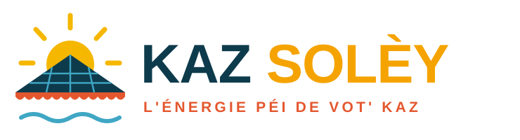

<p align="center"></p>

# SP Energy – Kit de lancement d'une entreprise photovoltaïque à La Réunion

*« L'énergie péi de vot' kaz. »* – Installation de centrales solaires (autoconsommation,
batteries, vente du surplus) pour particuliers, professionnels et copropriétés à La Réunion.

Tout ce qu'il faut pour **lancer la machine**, sans repartir de zéro :

| # | Livrable | Fichier |
|---|---|---|
| 1 | Étude de marché & données Réunion (ensoleillement, parc, prix, concurrence) | [`docs/01-marche-et-donnees.md`](docs/01-marche-et-donnees.md) |
| 2 | Toutes les aides & financements (prime ZNI, KAP Région, TVA DOM, FEDER, prêts…) | [`docs/02-aides-et-financements.md`](docs/02-aides-et-financements.md) |
| 3 | Création de la société & infrastructures (statut, RGE, assurances, outils, stock) | [`docs/03-creation-et-infrastructures.md`](docs/03-creation-et-infrastructures.md) |
| 4 | Argumentaire commercial, scripts, objections, mails de prospection | [`docs/04-argumentaire-commercial.md`](docs/04-argumentaire-commercial.md) |
| 5 | Instagram : bio, grille, 12 premiers posts, reels, hashtags | [`docs/05-instagram.md`](docs/05-instagram.md) |
| 6 | Plan de lancement 90 jours + prévisionnel année 1 | [`docs/06-plan-lancement-et-previsionnel.md`](docs/06-plan-lancement-et-previsionnel.md) |
| 7 | Logo & charte graphique | [`brand/`](brand/charte.md) |
| 8 | Site web vitrine prêt à mettre en ligne (avec simulateur d'économies) | [`site/`](site/) |
| 9 | Visuels Instagram prêts à publier (photo de profil + posts de lancement) | [`instagram/`](instagram/) |

## Voir le site

Le site est 100 % statique (HTML/CSS/JS, aucune dépendance) :

```bash
cd solaire/site
python3 -m http.server 8080   # puis http://localhost:8080
```

Mise en ligne gratuite possible sur Netlify, Cloudflare Pages ou GitHub Pages (glisser le dossier
`site/`). Le formulaire de contact fonctionne via Netlify Forms ou un `mailto:` de secours.

**Mettre à jour les chiffres** (tarifs CRE trimestriels, primes, prix du kWh) : un seul fichier,
[`site/js/config.js`](site/js/config.js). Le simulateur et les pages s'adaptent.

## Synergies avec l'écosystème existant

- **Immo Réseau** : chaque mandataire devient apporteur d'affaires (vendeurs qui veulent
  valoriser leur bien, acquéreurs qui rénovent). Une maison avec centrale solaire et factures
  réduites se vend avec un argument concret.
- **Sakura Palm Conciergerie** : les propriétaires de locations saisonnières (clim, piscine,
  eau chaude) sont la cible n°1 de l'autoconsommation : la consommation a lieu en journée.
- **Fighter Academy Karaté** : partenariat sponsor local (visibilité au dojo, événements),
  et toiture du dojo comme vitrine.

> ⚠️ Les tarifs d'achat et primes ZNI sont révisés **chaque trimestre** par la CRE. Les montants
> du dossier sont ceux connus en novembre 2026 ; vérifier sur le site de la CRE avant chaque devis.
