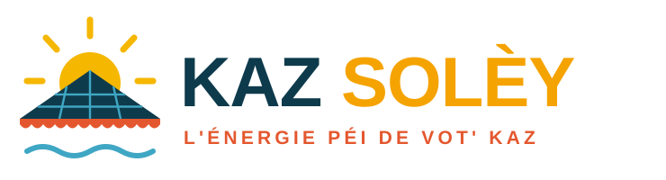

# Charte graphique – SP Energy

> **Nom :** SP Energy
> **Signature :** *L'énergie péi de vot' kaz.*
> **Signature pro :** *Votre toit travaille. Vous encaissez.*

⚠️ À vérifier avant dépôt : disponibilité de « SP Energy » à l'INPI (classes 37, 40, 42) et au
registre du commerce, du domaine `spenergy.re` et du compte Instagram `@spenergy974`
(`@spenergy` seul est probablement déjà pris).

## Le logo

Un seul dessin, trois idées réunionnaises :

| Élément | Ce qu'il raconte |
|---|---|
| **Toit de case créole** quadrillé | Le toit *est* le panneau solaire : votre kaz devient une centrale |
| **Lambrequins** orange | La dentelle de bois des cases créoles : patrimoine, savoir-faire, ancrage local |
| **Soleil levant** | L'île intense : 1 400 à 1 650 kWh produits par kWc et par an selon les zones |
| **Vague lagon** | Le littoral, la mer… et l'énergie qui circule |

Fichiers :
- `logo.svg` – logo horizontal (fond clair)
- `logo-blanc.svg` – logo horizontal (fond bleu nuit / photo)
- `logo-icon.svg` – emblème seul (photo de profil Instagram, favicon, sticker véhicule)
- `../instagram/*.png` – rendus PNG

Zone de protection : la hauteur du soleil tout autour. Taille mini : 24 mm (emblème 10 mm).
Ne jamais déformer, recolorer le soleil autrement qu'en jaune, ni poser le logo bleu sur fond bleu.

## Couleurs

| Nom | Code | Usage |
|---|---|---|
| Bleu nuit lagon | `#0E3B4C` | Textes, fonds premium, toit |
| Jaune solèy | `#F5B700` (texte : `#F5A300`) | Soleil, boutons d'action, chiffres clés |
| Orange flamboyant | `#E4572E` | Accents, lambrequins, alertes « offre » |
| Bleu lagon | `#3FA7C4` | Liens, données, cellules |
| Vert canne | `#5E8C3A` | Écologie, économies, validations |
| Sable | `#FFF8EC` | Fond clair |

## Typographies (Google Fonts, gratuites)

- **Montserrat ExtraBold 800** – titres, chiffres (« – 70 % sur la facture »)
- **Inter 400/600** – textes, devis, site

## Ton de voix

Mélange calculé **Harvey Specter** (assurance, chiffres, gagner) et **Raymond Reddington**
(récit, calme, la phrase qui reste). Phrases courtes. Un chiffre par message. Jamais de
promesse de « panneaux gratuits ». Un mot de créole par post maximum, bien placé.

- ✅ « Votre toit reçoit le soleil gratuitement. La question, c'est : qui encaisse ? »
- ✅ « Je ne vends pas des panneaux. Je vends 20 ans de factures que vous ne paierez plus. »
- ❌ « Panneaux solaires 100 % financés par l'État !!! » (pratique interdite et toxique pour la marque)
